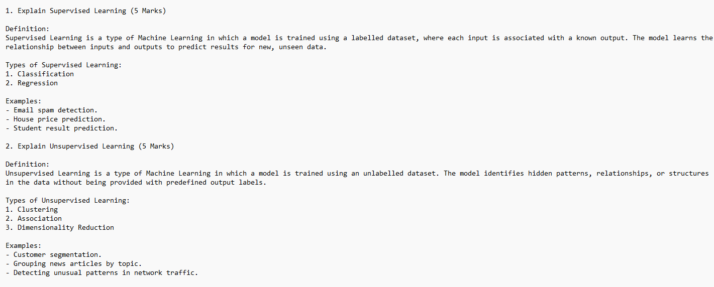
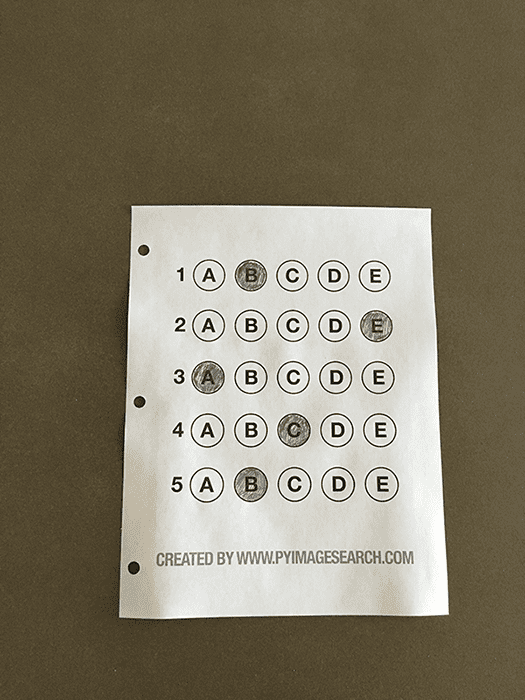

<div align="center">

# 📝 EvalMe

### AI-Powered Student Assessment System

Grade handwritten descriptive answers and OMR sheets in one workflow, with less manual effort.


</div>

---

## ✨ Features

| | Feature | What it does |
|---|---|---|
| 🧠 | **AI Answer Evaluation** | Scores descriptive answers with Gemini for concept, relevance, accuracy and completeness, with partial credit and a short explanation per question. |
| 🔢 | **Question-number matching** | Maps answers to the key by question number, even when students answer out of order (e.g. Q2 before Q1). |
| 🎯 | **OMR Analysis** | Detects marked bubbles on a scanned sheet and compares them against the OMR key. |
| 🔍 | **OCR processing** | Extracts text from handwritten or scanned sheets, with a chance to review the extracted text. |
| 📊 | **Evaluation report** | Question-wise marks, total score, max marks and percentage, with optional export. |

---

## 🎬 Demo

### 🧠 Answer Evaluation

<div align="center">

| Answer Sheet | Answer Key |
|:---:|:---:|
|  |  |

<br>


</div>

> The sample sheet answers **Supervised Learning** and **Unsupervised Learning** with Q2 written before Q1. The key allocates 5 marks per question.

### 🎯 OMR Analysis

<div align="center">

| Student OMR Sheet | OMR Key |
|:---:|:---:|
|  |  |

<br>


</div>

---

## 🛠️ Tech Stack

- **Python**: application logic
- **Streamlit**: web interface
- **Google Gen AI SDK (`google-genai`)**: Gemini-based answer evaluation
- **OCR & image processing**: text extraction and OMR detection
- **Pandas**: tabular results and reports

> Check `requirements.txt` for the exact OCR and computer-vision libraries.

---

## 🚀 Getting Started

**Prerequisites:** Python 3.10+, Git, and a [Gemini API key](https://aistudio.google.com/apikey).

**1. Clone**

```bash
git clone <YOUR_REPOSITORY_URL>
cd <YOUR_PROJECT_DIRECTORY>
```

**2. Create a virtual environment**

```powershell
# Windows PowerShell
python -m venv .venv
.\.venv\Scripts\Activate.ps1
```

```bash
# macOS / Linux
python3 -m venv .venv
source .venv/bin/activate
```

**3. Install dependencies**

```bash
python -m pip install --upgrade pip
python -m pip install -r requirements.txt
```

Make sure `google-genai` is included.

**4. Set your Gemini API key**

```powershell
# PowerShell (current session)
$env:GEMINI_API_KEY = "YOUR_GEMINI_API_KEY"
```

Or create `.streamlit/secrets.toml`:

```toml
GEMINI_API_KEY = "YOUR_GEMINI_API_KEY"
```

> ⚠️ Never commit secrets. Add `.streamlit/secrets.toml` and any `.env` file to `.gitignore`.
> To change the model, set `GEMINI_MODEL` to an identifier available to your API key.

**5. Run**

```bash
python -m streamlit run app.py
```

Open the local URL that Streamlit prints.

---

## 🔄 Workflow

1. **Choose** a mode: Answer Evaluation or OMR Analysis.
2. **Upload** the answer key and student submission(s).
3. **Review** the extracted text or detected OMR responses.
4. **Run** the evaluation.
5. **Check** per-question marks, explanations and the total score.
6. **Export** the report, if enabled.

---

## ⚠️ Evaluation Notes

- **Review AI scores.** Gemini marks are estimates; educator verification is recommended.
- **OCR is imperfect.** Handwriting, shadows, rotation and low contrast can cause errors.
- **Question labels matter.** Missing or ambiguous numbers should be reviewed, not silently accepted.
- **OMR image quality matters.** Lighting, alignment and bubble marks affect detection.
- **Alternative answers are valid.** The evaluator awards credit for correct explanations beyond the key.
- **Protect student data.** Gemini evaluation sends prompt content to Google's API, so confirm this is permitted by your institution's privacy policy.

---

## 📁 Project Structure

```text
sas-system/
├── app.py
├── modules/
│   ├── ans_eval.py
│   ├── plagiarism_check.py
│   └── ...
├── assets/                 # README images and demo GIFs
├── requirements.txt
├── .streamlit/
│   └── secrets.toml        # local only; do not commit
└── README.md
```

---

## 🧯 Troubleshooting

<details>
<summary><code>ImportError: cannot import name 'genai' from 'google'</code></summary>

Install the current SDK in the same virtual environment used to run Streamlit:

```bash
python -m pip install --upgrade google-genai
python -c "from google import genai; print('Gemini SDK import successful')"
```

Also check that the project has no conflicting `google.py` file or `google/` directory.
</details>

<details>
<summary><code>ModuleNotFoundError: No module named 'google.generativeai'</code></summary>

That import belongs to the legacy `google-generativeai` SDK. If the code uses `google-genai`, migrate the API calls as well as the import.
</details>

<details>
<summary><code>404 NOT_FOUND</code> from Gemini</summary>

The model name is not available for your API key. Update `GEMINI_MODEL` (or the default in the code) to a currently supported model.
</details>

<details>
<summary>No questions found or wrong question matching</summary>

Inspect the extracted OCR text and parsed question numbers. Confirm the answer key has clear question headings and, if the parser needs them, explicit marks per question.
</details>

---

## 🗺️ Roadmap

- [ ] Manual review and score override
- [ ] Confidence indicators for OCR and OMR results
- [ ] Batch processing and class-level reports
- [ ] Better handling of varied numbering and multi-page submissions
- [ ] Tests for parsing, scoring totals and OMR detection
- [ ] Audit trail for teacher adjustments

---

## 🤝 Contributing

1. Fork the repository.
2. Create a feature branch.
3. Add tests for parsing, scoring or image-processing changes.
4. Open a pull request with a concise description.

---

## 📄 License

Add the license that applies to this project. Until one is included, reuse and redistribution terms are unclear.
